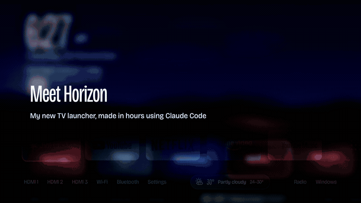
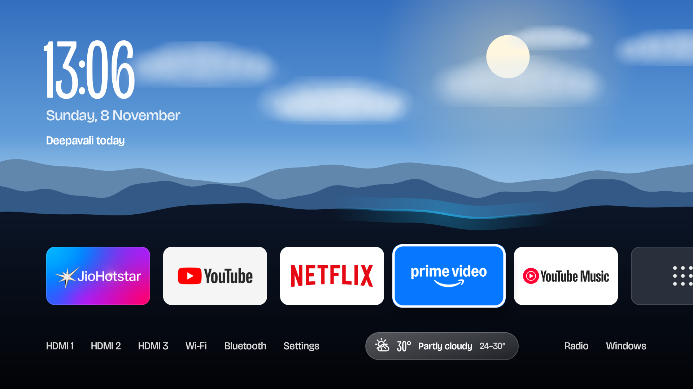
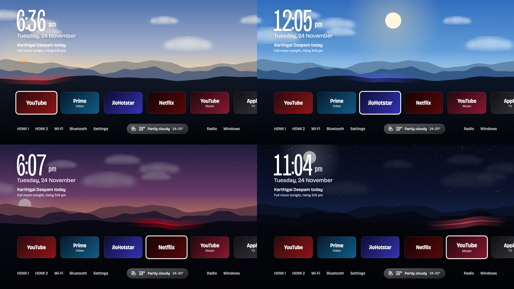
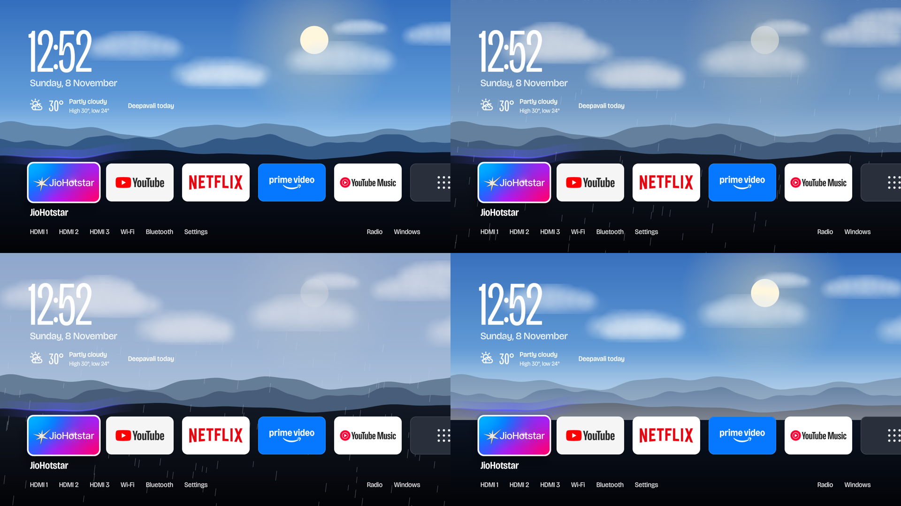
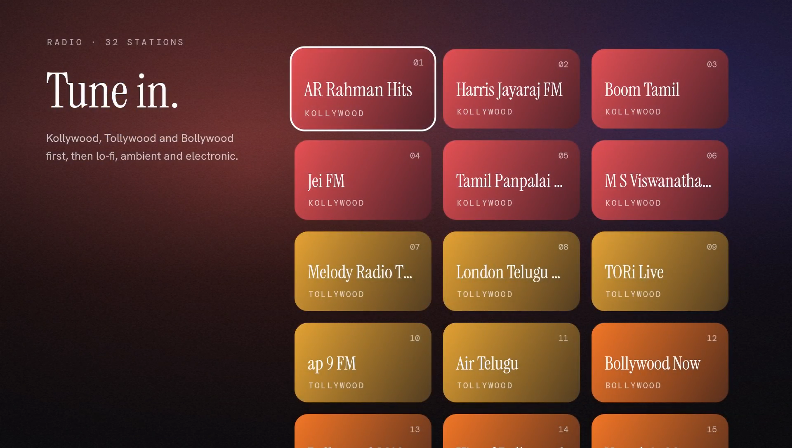

# Horizon

**A calm, live home screen for Android TV / Google TV.** The sky follows the real sun and moon over
wherever your TV is, the weather plays out in the clouds, festival days and full moons show up on
the date line, and your apps sit on the horizon. No root, and it switches back to the stock home
screen in one tap.

Made in hours with [Claude Code](https://claude.com/claude-code).



▶ **[Watch the 34-second video](docs/media/horizon.mp4)**

<video src="docs/media/horizon.mp4" controls muted width="100%"></video>

| Home | Day to night, with a full moon |
|---|---|
|  |  |
| **Weather in the sky** | **Radio** |
|  |  |

## What it does

| | |
|---|---|
| **Live sky** | Sky colour follows the sun's real altitude. The sun and moon sit where they really are (looking south, east on the left), the moon shows its real phase and tilt, and stars come out after dark. |
| **Weather in the sky** | Live weather from [Open-Meteo](https://open-meteo.com) (free, no key): drifting clouds, grey overcast, storm flashes, fog. A glass pill in the bottom bar shows temperature, condition and today's range. |
| **Today line** | Festivals (Deepavali, Pongal, Karthigai Deepam, Christmas, Eid…) and sky events: full moon with moonrise time, supermoon, new moon, meteor-shower peaks, solstices and equinoxes. |
| **Apps on the horizon** | Your streaming apps as banners. The focused app lifts and lights the hill edge in its brand colour. The row orders itself by what you actually watch. |
| **All apps** | Every installed app, A to Z, plus a one-press way back to the original home screen. |
| **Radio** | 32 stations: Kollywood, Tollywood and Bollywood first, then lo-fi, ambient and electronic. Live spectrum visualiser and a sleep timer that fades out. |
| **The World's Windows** | Long, real window views (trains, rooms, coasts) with natural sound. |
| **Location** | Found automatically from the TV's internet connection (or Android's location), refreshed daily. |

## Requirements

- An **Android TV / Google TV** on Android 8 or newer, on the same Wi-Fi as your computer. Built and
  tested on a TCL Smart TV Pro (Google TV, Android 11).
- A development machine with **Java 17** and **Android SDK tools**.

### macOS (with Homebrew)

```bash
brew install --cask android-platform-tools android-commandlinetools
brew install openjdk@17
export JAVA_HOME=/opt/homebrew/opt/openjdk@17
yes | sdkmanager --sdk_root="$HOME/Library/Android/sdk" "platform-tools" "build-tools;34.0.0" "platforms;android-34"
```

### Linux (Ubuntu/Debian)

```bash
sudo apt-get update
sudo apt-get install -y openjdk-17-jdk android-platform-tools
# Download Android Command Line Tools from https://developer.android.com/studio#command-tools
unzip commandlinetools-linux-*.zip -d ~/android-sdk
mkdir -p ~/android-sdk/cmdline-tools/latest
mv ~/android-sdk/cmdline-tools/* ~/android-sdk/cmdline-tools/latest
export JAVA_HOME=/usr/lib/jvm/java-17-openjdk-amd64
export PATH="$HOME/android-sdk/cmdline-tools/latest/bin:$PATH"
yes | sdkmanager --sdk_root="$HOME/android-sdk" "platform-tools" "build-tools;34.0.0" "platforms;android-34"
```

### Windows (PowerShell)

```powershell
# Install Java 17 from https://adoptium.net/ or use Chocolatey
choco install adoptopenjdk17

# Download Android Command Line Tools from https://developer.android.com/studio#command-tools
# Extract to C:\Android\cmdline-tools\latest
$env:JAVA_HOME = "C:\Program Files\Eclipse Adoptium\jdk-17.*"
$env:Path += ";C:\Android\cmdline-tools\latest\bin"
yes | sdkmanager --sdk_root="C:\Android" "platform-tools" "build-tools;34.0.0" "platforms;android-34"
```

No Gradle and no Android Studio: the launcher builds with plain `javac`, `d8` and `aapt2`.

## Quick start

1. **On the TV**, turn on developer options: Settings › Device Preferences › About › press OK on
   **Build** seven times. Then in Developer options turn on **USB debugging** (and **Network
   debugging** if your TV has it). Note the TV's IP address from Settings › Network.
2. **Connect** (accept "Allow debugging?" on the TV and tick *Always allow*):
   ```bash
   scripts/horizon-connect.sh 192.168.0.106
   ```
3. **Pick your apps** in [`config/apps.json`](config/apps.json) (see *Settings* below).
4. **Build and install:**
   ```bash
   scripts/horizon-build.sh
   scripts/horizon-on.sh
   ```
   Press Home on the remote. You're on Horizon.

### Going back to the stock home screen

Horizon never disables or uninstalls anything. Google TV stays installed and enabled.

| Where | How |
|---|---|
| On the TV | **All apps › Use the original home screen**, turn off *Horizon Home button*, press Home |
| From the computer | `scripts/horizon-off.sh` (keeps Horizon installed) or `scripts/horizon-off.sh --remove` (uninstalls it) |
| Turn it back on | `scripts/horizon-on.sh` |

## Settings

Everything you'd want to change lives in [`config/`](config/). Edit, then run
`scripts/horizon-build.sh && scripts/horizon-on.sh` to apply.

| File | What it controls |
|---|---|
| [`config/apps.json`](config/apps.json) | The apps on the home row: Android package, label and an accent colour (used for the hill light). The order here is the starting order; after that the row sorts itself by how much you watch each app. Apps that aren't installed are skipped. |
| [`config/features.json`](config/features.json) | Switch sections on or off: `radio`, `worldsWindows`, `retroTv`, `littleOffice`, `debugWebViews`. |
| [`config/sky.json`](config/sky.json) | Fallback location (`lat`, `lon`). Only used until the TV's location is detected. |
| [`config/festivals.json`](config/festivals.json) | Festival and holiday dates (`YYYY-MM-DD`). Shown today, tomorrow, or up to 3 days ahead. Mark moon-sighting dates with `"expected": true`. |
| [`config/stations.json`](config/stations.json) | Radio stations: `title` ("Name — Subtitle"), stream `url`, `genre`, tile `color`. |
| [`config/windows.json`](config/windows.json) | The World's Windows videos (YouTube IDs, place, mood). |

**Example: add an app.** Find its package with
`adb shell pm list packages | grep -i <name>`, then:

```json
{ "package": "com.netflix.ninja", "label": "Netflix", "accent": "#E50914" }
```

**Design tokens** (in code, if you want to restyle):

| Where | What |
|---|---|
| `launcher/src/tv/steroid/home/Sky.java` | Sky colours per sun altitude (`MORNING`, `EVENING`), horizon height (`GROUND`), hills, clouds, rain/fog, moon seas |
| `launcher/src/tv/steroid/home/Home.java` | Layout, clock and type sizes, card size, glass style (`glass()`) |
| `launcher/assets/fonts/display.ttf` | Bricolage Grotesque (variable width and weight), SIL OFL |

## Remote controls

| Screen | Keys |
|---|---|
| Home | ◀ ▶ move along the apps · ▼ bottom bar (inputs, Wi-Fi, Bluetooth, Settings, Radio, Windows) · OK open · Home always returns to the first app |
| All apps | D-pad to move, OK to open, Back for home |
| Radio, Now Playing | ◀ ▶ station · OK pause · ▲ sleep timer (15 / 30 / 60 / 90 min, then off) · ▼ stop · Back for stations |

## How it takes over the Home button

Google TV sends the remote's Home button to its own launcher whatever the default home app is.
Horizon handles this without touching any Google app:

- **`HomeKey`** (an accessibility service) catches Home presses and opens Horizon, and swaps Horizon
  in when Google TV's home screen comes to the front (after a reboot, or when an app exits "to home").
- **`Watchdog`** restarts that service after boot. TCL's memory guard kills apps shortly after startup,
  which otherwise leaves the service marked as crashed. It only restarts a service you still have
  switched on, so turning it off always sticks.

`scripts/horizon-on.sh` grants what this needs over adb: the accessibility service, TCL's
`APP_AUTO_START` app-op, `WRITE_SECURE_SETTINGS` (only to restart its own service), usage access
(for app ordering) and coarse location.

## Troubleshooting

| Symptom | Fix |
|---|---|
| Home goes to Google TV | Check Settings › Accessibility › *Horizon Home button* is on, or re-run `scripts/horizon-on.sh`. |
| Home goes to Google TV for ~10 s after a reboot | Expected on TCL: the watchdog restarts the Home button about 20 s after boot. |
| Black screen after disabling Google TV Home | Don't disable `launcherx`: Google's setup app then takes over Home with a blank screen. Run `scripts/horizon-off.sh` to restore. |
| `failed to connect … Connection refused` | Network debugging is off, or the TV uses Wireless debugging with a different port. Pass `ip:port`. |
| A radio station won't play | Free stream links move. Replace its `url` in `config/stations.json`. Stations can take a few seconds to tune. |
| Test the weather sky | `adb shell am start -n tv.steroid.home/.Home --ei weatherTest 63` (63 rain, 95 storm, 45 fog, 3 overcast, 0 clear; `-1` for live) |

## Repository layout

```
config/            everything you'd customise (see Settings)
launcher/          the Android app: src/, assets/ (fonts, pages), res/, AndroidManifest.xml
scripts/
  horizon-connect.sh   connect to the TV and remember it
  horizon-build.sh     build launcher/out/SteroidHome.apk
  horizon-on.sh        install + take over Home (reversible)
  horizon-off.sh       restore the original home screen [--remove]
preview/horizon.html   browser preview of the design (time-of-day, city, date and weather controls)
video/             the promo video: build_video.sh, mix_voice.sh, music.py, captions, voice-over
docs/media/        screenshots and the video
docs/reference/    phase guides from the original Steroid TV playbook
```

**Preview in a browser:** `cd preview && python3 -m http.server 8765`, then open
<http://localhost:8765/horizon.html>. Arrow keys work like the remote.

**Rebuild the video:** `video/build_video.sh` (needs the raw recordings), then
`video/mix_voice.sh` to lay `video/audio.mp3` and the music over it.

## Credits

- Built on [Steroid TV](https://github.com/sanchit0212s/steroid-tv) by Sanchit Singhal (MIT): build
  pipeline, Radio, The World's Windows and the original playbook.
- Astronomy adapted from [SunCalc](https://github.com/mourner/suncalc) by Vladimir Agafonkin (BSD-2-Clause).
- Weather: [Open-Meteo](https://open-meteo.com). Location: [ipapi.co](https://ipapi.co).
- Fonts: Bricolage Grotesque, Instrument Serif, Hanken Grotesk, DM Mono (SIL Open Font License).
- Radio streams belong to their broadcasters; World's Windows videos to their YouTube creators.

## License

MIT (see [LICENSE](LICENSE)). Fonts under SIL OFL 1.1 (licences in `launcher/assets/fonts/`).
